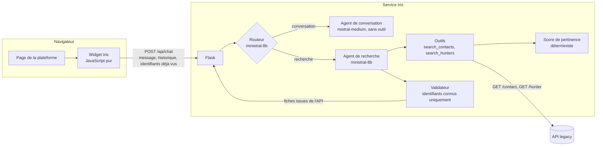

# Iris

Agent conversationnel de recherche de contacts, branché sur l'API d'une plateforme ancienne.

Iris aide les membres d'un cabinet d'outplacement de dirigeants à trouver, dans le réseau du cabinet, les dirigeants et les cabinets de chasseurs de tête à contacter. Le membre écrit « un directeur financier chez TotalEnergies », Iris répond avec des fiches de contacts réels.

Ce dépôt est la **version de démonstration** d'un agent que j'ai conçu et livré en production pour un client, en freelance. Le projet d'origine est confidentiel : le code a été réécrit, le client est remplacé par un cabinet fictif, et toutes les données sont générées. L'architecture, les contraintes et les choix de conception sont ceux du projet réel.

## Le problème

Le réseau du cabinet compte plusieurs centaines de milliers de contacts, importés par les membres depuis leurs réseaux professionnels. La plateforme ne propose qu'un formulaire de filtres. Il faut savoir quoi chercher, et l'essentiel du réseau reste inexploité.

Une contrainte domine toutes les autres : **l'agent ne doit jamais présenter un contact qui n'existe pas**. Un dirigeant inventé, ou un vrai nom associé à un mauvais poste, détruit la confiance dans l'outil dès la première occurrence.

## Contraintes réelles du projet

Elles expliquent la plupart des choix techniques.

| Contrainte | Conséquence |
|---|---|
| **Plateforme ancienne en PHP**, sans chaîne de compilation front | Widget en JavaScript pur, un seul fichier, intégré par une balise `<script>`. Aucun framework. |
| **Serveur de production ancien**, Python 3.9, serveur d'application imposé | Flask plutôt qu'un framework asynchrone, et un pont entre Flask et le code asynchrone de l'agent. En production, les bibliothèques sont figées sur d'anciennes versions compatibles. Cette démonstration utilise des versions récentes. |
| **API sans filtre par secteur** | Un secteur est traduit en liste d'entreprises, interrogées en parallèle. |
| **API qui cherche par sous-chaîne** | « directeur commercial » ne trouve pas « Sales Director ». L'outil élargit lui-même la recherche, puis le modèle fait le rapprochement. |
| **Résultats sans ordre de pertinence**, tronqués par un paramètre `limit` | Un score déterministe classe le lot avant le modèle. |
| **Données incomplètes** : un quart des contacts a un profil LinkedIn, email et téléphone sont rares | Seuls les contacts joignables sont proposés. |
| **Enrichissement des coordonnées limité à 10 résultats par appel** | Désactivé pendant la recherche, il casserait la pagination. |
| **Cabinets de chasseurs de tête sans spécialité renseignée** | Le texte qui les présente est fixe, pour que le modèle ne leur invente pas de spécialité. |
| **Latence** : l'utilisateur attend une réponse en quelques secondes | Petit modèle pour le routage et la recherche, délai maximal à chaque étape, réponse de secours. |
| **Coût** : usage quotidien par tous les membres | Modèle le moins cher qui tienne la qualité : environ 0,7 dollar pour 1 000 requêtes. |
| **RGPD** : données personnelles de dirigeants | Modèles d'un éditeur européen, données traitées en Europe. Le modèle ne reçoit ni email ni téléphone. |
| **Client non technique** | Chaque règle de classement doit pouvoir s'expliquer en une phrase, d'où un score lisible plutôt qu'un modèle opaque. |

## Architecture



Traitement d'un message :

1. **Routage.** Un appel court au modèle décide : recherche ou simple conversation. Hors recherche, un agent sans outil répond en une ou deux phrases. Il ne peut pas présenter de contact, puisqu'il n'a accès à aucune donnée.
2. **Recherche.** L'agent appelle un outil. Les contacts renvoyés par l'API sont convertis, classés par le score, filtrés (joignables, pas déjà montrés), puis transmis au modèle sous une forme réduite, sans coordonnées.
3. **Sélection.** Le modèle renvoie des **identifiants**, jamais de fiches. Le validateur écarte tout identifiant absent des résultats. Les fiches envoyées au widget sont celles de l'API.
4. **Pagination.** Le widget renvoie les identifiants déjà affichés. Ils sont retirés du lot avant que le modèle ne le voie.

Le service ne stocke rien : ni base de données, ni session. L'historique est porté par le widget.

## Choix de conception

**Le modèle choisit des identifiants, il ne rédige pas les fiches.** C'est le cœur du projet. Une consigne « n'invente rien » est une demande, un validateur est une garantie. Un contact absent des résultats ne peut pas atteindre l'écran, quel que soit le comportement du modèle.

**Un routeur avant l'agent de recherche.** Sans lui, tous les modèles testés lançaient une recherche sur un simple « bonjour ». Le problème venait de l'architecture, pas de la taille du modèle : un agent à qui l'on donne des outils les utilise.

**Deux modèles.** Le petit modèle suffit quand la sortie est structurée et contrôlée (routage, sélection). La conversation est du texte libre, plus risqué : elle passe par un modèle plus solide, à température nulle, avec une réponse courte et un garde-fou qui remplace toute réponse hors périmètre.

**Un score déterministe plutôt qu'un classement par le modèle.** Gratuit, instantané, testable, et explicable au client. Ses poids ont été fixés à la main avec le client. L'évaluation montre qu'il sert surtout quand le lot dépasse ce qu'on peut transmettre au modèle (voir l'expérience 2).

**Des délais partout.** Chaque étape a un délai maximal (12 s pour le routage, 18 s pour la conversation, 40 s pour la recherche, 30 s par appel au modèle) et une réponse de secours. Le nombre d'appels au modèle par recherche est plafonné à 6.

**Flask avec une boucle asyncio dans un thread.** Le framework d'agents est asynchrone, le serveur imposé ne l'est pas. Une boucle unique tourne dans un thread de fond et reçoit toutes les exécutions. Elle démarre au premier message et se recrée après duplication du processus, pour supporter les serveurs qui chargent l'application avant de se dupliquer. Sans contrainte, je prendrais un framework asynchrone et ce pont disparaîtrait.

**Le code garantit, le modèle propose.** Le nombre de contacts demandé, l'absence de doublon en pagination, le nombre annoncé dans le texte : tout ce qui peut être vérifié par du code l'est, plutôt que confié à une consigne.

## Évaluation

Le jeu d'évaluation compte **47 cas** sur les données fictives, chacun joué **3 fois**. Les données étant générées, la vérité terrain est connue : le générateur attribue à chaque contact un secteur, une fonction, un niveau hiérarchique et un pays, que l'API n'expose pas et que l'agent ne voit jamais. Les étiquettes ne viennent donc pas des mots-clés du score évalué.

Chaque contact proposé reçoit une note : 2 s'il répond exactement à la demande, 1 s'il est acceptable (bonne entreprise mais autre fonction, cadre intermédiaire, filiale, poste à l'étranger), 0 s'il est hors cible.

Les valeurs sont des moyennes par cas, avec leur intervalle de confiance à 95 % obtenu par bootstrap sur les cas. Tout se relance avec `python -m eval.run`. Le détail est dans [eval/results/RESULTATS.md](eval/results/RESULTATS.md).

### Résultats de la version actuelle

| Métrique | Valeur [IC 95 %] | Ce qu'elle mesure | Interprétation |
|---|---|---|---|
| Routage | 100 % (41 cas) | L'intention détectée est la bonne | Sans erreur sur ce jeu. Le jeu ne contient pas de cas volontairement ambigus : c'est un plancher de difficulté, pas une preuve. |
| Bon outil | 99 % [98 ; 100] | L'outil attendu est appelé | Bon. |
| Précision@8 | 99 % [98 ; 100] | Part des contacts proposés qui sont pertinents (note 1 ou 2) | Iris ne propose presque jamais un contact hors cible. |
| Précision stricte@8 | 79 % [70 ; 88] | Part des contacts proposés qui répondent exactement (note 2) | Un contact proposé sur cinq est seulement « acceptable » : bonne entreprise, mais autre fonction ou poste à l'étranger. |
| nDCG@8 | 0,74 [0,63 ; 0,83] | Qualité du choix et de l'ordre, rapportée au meilleur résultat possible | Correct, perfectible. La perte vient surtout de contacts pertinents non proposés. |
| Réponse utile | 90 % [80 ; 98] | Au moins un contact pertinent proposé quand il en existe | Dans un cas sur dix, Iris répond qu'elle n'a rien alors qu'un contact existait. C'est le défaut le plus gênant pour l'utilisateur. |
| Priorité France | 85 % [79 ; 91] | Part des contacts proposés basés en France | La consigne est suivie imparfaitement : elle repose sur le modèle, qui ne voit le pays que dans l'intitulé du poste. |
| Réponse vide attendue | 100 % (13 cas) | Aucun contact présenté quand il n'y a rien à présenter | Salutations, hors périmètre, entreprise absente : jamais de contact à tort. |
| Nombre demandé | 100 % (3 cas) | « Donne-moi 3 contacts » en renvoie 3 | Garanti par le code. |
| Pagination sans doublon | 100 % (3 cas) | « D'autres » ne répète aucun contact | Garanti par le code. |
| Texte conforme | 100 % (9 cas) | Ni email inventé, ni nom de célébrité, ni consigne détournée | Les trois tentatives d'injection échouent. Trois cas ne font pas une étude de sécurité. |
| Identifiants inventés par le modèle | 0 % [0 ; 1] | Identifiants proposés que le validateur a dû écarter | Un identifiant écarté sur 378 proposés. Après validation, le taux affiché est nul par construction. |
| Message fidèle | 77 % [66 ; 89] | Messages d'introduction jugés fidèles aux fiches par un juge LLM | Point faible restant. Voir « Juge LLM ». |
| Échec technique | 0 % | Réponse de secours (délai, limite d'appels) | Aucun sur 141 exécutions. |
| Latence | médiane 3,1 s, 95e centile 5,5 s | Durée d'une réponse | Acceptable pour une recherche. La fausse API répond instantanément : en production, ajouter le temps de l'API réelle. |
| Coût | 0,00066 $ par requête | Tokens consommés aux prix publics | Environ 0,7 $ pour 1 000 requêtes. |
| Stabilité | Jaccard 0,84 | Recouvrement des contacts entre deux exécutions du même cas | Deux exécutions de la même demande partagent la plupart de leurs contacts, pas tous. L'intention, elle, est identique dans 100 % des cas. |

### Avant et après les corrections

La première évaluation du portage fidèle a révélé des défauts. Chaque correction est une option du code, ce qui permet de rejouer exactement la version d'avant. Le test est apparié, cas par cas (test de permutation).

| Métrique | Avant | Après | Différence [IC 95 %] | p |
|---|---|---|---|---|
| nDCG@8 | 0,59 | 0,74 | +0,14 [+0,05 ; +0,24] | 0,012 |
| Réponse utile | 76 % | 90 % | +14 points [+3 ; +27] | 0,036 |
| Message fidèle | 39 % | 73 % | +34 points [+21 ; +49] | < 0,001 |
| Échec technique | 16 % | 0 % | -16 points [-27 ; -5] | 0,016 |
| Latence moyenne | 4,4 s | 3,4 s | -1,1 s [-1,6 ; -0,5] | < 0,001 |
| Précision@8 | 99 % | 99 % | 0 | 1,0 |
| Nombre demandé | 100 % | 100 % | 0 | 1,0 |

Les corrections, et ce que chacune traite :

- **Élargissement automatique du poste.** Quand le filtre sur le poste ne renvoie aucun contact joignable, l'outil relance la recherche sans ce filtre et demande au modèle de ne retenir que les postes équivalents. C'est le gain principal : l'API cherche par sous-chaîne, et le modèle enchaînait les synonymes avant d'abandonner.
- **Verrou sur l'entreprise citée par le membre.** Dans la version d'origine, « un CFO chez Airbus » proposait des directeurs financiers de l'automobile. L'outil refuse maintenant de quitter une entreprise que le membre a nommée.
- **Arrêt après trois recherches vides.** Le modèle conclut au lieu d'épuiser ses appels. C'est ce qui supprime les échecs techniques et réduit la latence.
- **Message d'introduction neutre.** Le modèle ne décrit plus les profils dans son texte. Avant, il annonçait par exemple « un COO/CFO équivalent » qu'aucune fiche ne montrait.
- **Nombre annoncé corrigé.** Un message qui annonce 8 contacts sous 7 fiches est corrigé par le code.
- **Nombre demandé garanti.** Lecture du nombre dans la demande, puis troncature par le code.

Deux résultats négatifs, à dire tels quels :

- Le défaut « 3 contacts demandés, 7 renvoyés », observé sur le système d'origine, **ne se reproduit pas** avec la version du modèle utilisée ici (100 % avant comme après). La garantie par le code reste utile, mais je ne peux pas en montrer l'effet sur ce jeu.
- Ma première version du verrou d'entreprise **dégradait** les résultats (nDCG de 0,61 à 0,55). Elle se déclenchait sur l'entreprise choisie par le modèle au lieu de celle citée par le membre. C'est l'évaluation qui l'a montré.

### Expérience 1 : identifiants ou fiches rédigées par le modèle

Même agent, mêmes outils, mais le modèle rédige lui-même les fiches (prénom, nom, poste, entreprise).

| | Sélection d'identifiants | Fiches rédigées |
|---|---|---|
| Fiches inventées | 0 % après validation | 0 % |
| Fiches altérées (poste ou entreprise modifié) | impossible | 0 % |
| Précision@8 | 99 % | 97 % |
| nDCG@8 | 0,74 | 0,72 |
| Latence moyenne | 3,0 s | 4,1 s |

**L'expérience ne montre pas d'invention.** Sur ces données, avec ce modèle, rédiger les fiches ne produit ni contact inventé ni fiche altérée. Je ne peux donc pas affirmer que la sélection d'identifiants « réduit les hallucinations de x % ». Ce qu'elle apporte est d'une autre nature : une garantie qui ne dépend ni du modèle ni de sa version, alors qu'un taux mesuré à 0 % sur 72 exécutions et 204 fiches n'exclut pas un cas sur mille en production. Elle est aussi plus rapide d'une seconde, parce que le modèle écrit moins. Les conditions sont par ailleurs favorables au modèle : lots courts, données propres.

### Expérience 2 : à quoi sert le score de pertinence

| Lot transmis au modèle | nDCG@8 |
|---|---|
| Classé par le score (version actuelle) | 0,74 |
| Ordre de l'API | 0,76 |
| Ordre aléatoire | 0,73 |
| Score seul, sans sélection par le modèle | 0,53 |

Deux enseignements. **Le modèle apporte quelque chose** : prendre les 8 premiers contacts du score, sans sélection, fait nettement moins bien. Et **l'ordre du lot n'a aucun effet mesurable** tant que tout le lot tient dans le contexte du modèle, ce qui est le cas ici (25 contacts au plus).

Le score sert quand il faut choisir ce qu'on transmet. En production, une recherche renvoie souvent plus de contacts que la limite. J'ai reproduit cette situation en réduisant le lot à 10 contacts :

| Lot réduit à 10 contacts | nDCG@8 | Précision stricte@8 |
|---|---|---|
| Classé par le score | 0,77 | 85 % |
| Ordre de l'API | 0,69 | 86 % |
| Ordre aléatoire | 0,66 | 68 % |

Contre l'ordre aléatoire, le score gagne 0,11 de nDCG [+0,04 ; +0,18] et 17 points de précision stricte, p = 0,011 dans les deux cas. Contre l'ordre de l'API, l'écart de nDCG va dans le même sens mais les intervalles se chevauchent : je ne conclus pas.

### Juge LLM

Le validateur garantit les fiches, pas le texte d'introduction. Un juge LLM vérifie que ce texte n'affirme rien que les fiches ne montrent pas : autre modèle que celui qui a produit la réponse, grille explicite à quatre types de problèmes, température nulle, sortie structurée.

Un juge n'a de valeur que comparé à un humain. Quinze réponses sont tirées pour une annotation manuelle à l'aveugle (`eval/annotations/a_annoter.csv`). Le script calcule alors l'accord et le kappa de Cohen. Cette annotation est en cours : tant qu'elle n'est pas faite, le juge n'est pas validé.

À la lecture des verdicts, le juge est sévère : il lui arrive de compter comme infidèle une formule vague. Le chiffre de 77 % est donc à prendre comme une borne basse, et la comparaison avant et après (même juge, mêmes règles) est plus fiable que la valeur absolue.

## Limites et pistes

- **Données fictives.** 500 contacts générés ne reproduisent ni le volume ni le désordre des données réelles. Les chiffres valent pour la comparaison entre variantes, pas comme prévision de la production.
- **Jeu d'évaluation modeste.** 47 cas donnent des intervalles larges, et certaines familles n'ont que deux ou trois cas. Le jeu a aussi servi à mettre au point les corrections : il faudrait un jeu de test séparé pour écarter un sur-ajustement.
- **Poids du score fixés à la main.** Avec les clics des membres sur les fiches, on pourrait les apprendre (régression logistique, puis apprentissage de classement) et comparer au score actuel sur ce même harnais.
- **Recherche lexicale.** L'élargissement compense la recherche par sous-chaîne sans la résoudre. Une recherche sémantique sur les intitulés de poste traiterait les synonymes à la source, au prix d'un index à maintenir.
- **Message d'introduction.** Un quart des messages reste jugé infidèle. La solution cohérente avec le reste du projet serait un texte construit par le code à partir des fiches.
- **Priorité France.** Elle repose sur le modèle. Un champ pays fiable dans l'API permettrait de la garantir par le code.
- **Observabilité.** Le service écrit une ligne JSON par requête (durées, tokens, outils). Il manque le suivi dans le temps : traces, alertes, et rejeu régulier de l'évaluation pour détecter une dérive du modèle.
- **Sécurité.** Les tentatives d'injection du jeu échouent, et les outils sont en lecture seule. Ce n'est pas un audit.

## Lancer le projet

Python 3.10 ou plus récent.

```bash
python -m venv venv
source venv/bin/activate              # Windows : venv\Scripts\activate
pip install -r requirements-dev.txt
cp .env.example .env                  # puis renseigner MISTRAL_API_KEY
```

Dans deux terminaux :

```bash
python -m legacy_api.app              # fausse API, port 5001
python -m backend.app                 # agent et page de démonstration, port 5000
```

Puis ouvrir http://127.0.0.1:5000. Ou, avec Docker :

```bash
docker compose up --build
```

Tests et évaluation :

```bash
pytest                                # 39 tests, sans clé API ni réseau
ruff check .
python -m eval.run                    # évaluation complète, résultats dans eval/results
python -m legacy_api.generate_data    # régénère les données (graine fixe)
```

L'évaluation complète joue environ 600 exécutions et 200 appels au juge, pour un coût de l'ordre de 0,70 dollar. Chaque exécution est mise en cache : une relance ne rappelle le modèle que pour ce qui a changé.

## Structure

```
backend/
  app.py           routes HTTP, validation des entrées, journal structuré
  agent.py         routeur, agents, outils, validateur, options
  api_client.py    client asynchrone de l'API, conversion des données
  scoring.py       score de pertinence et listes d'entreprises par secteur
  text.py          nettoyage du texte, nombre demandé, garde-fou de périmètre
  prompts.py       instructions des agents
  config.py        variables d'environnement
legacy_api/
  app.py           fausse API, avec les contraintes de l'originale
  generate_data.py générateur de données à graine fixe
public/
  iris-widget.js   widget en JavaScript pur
  theme.css        couleurs du widget
  index.html       page hôte de démonstration
eval/
  dataset.yaml     cas annotés
  truth.py         vérité terrain et notes de pertinence
  metrics.py       métriques, bootstrap, test apparié
  judge.py         juge LLM
  baselines.py     variante à fiches rédigées
  run.py           commande unique
tests/             tests unitaires, hors ligne
```

Jules Mortreux, ECE Paris et CentraleSupélec
